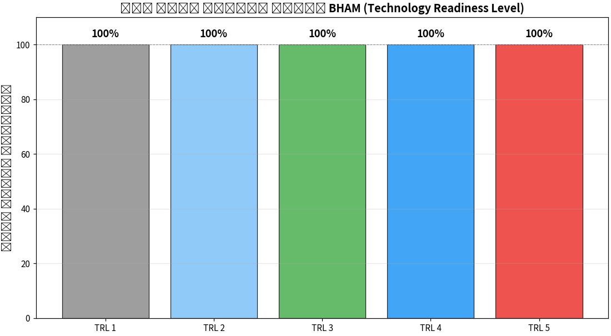

# BHAM — سامانه هوشمند مدیریت آلارم و پایش سلامت لایه‌های حفاظتی ایمنی فرآیند

<div dir="rtl">



**پروژه:** هوشمندسازی مدیریت آلارم و پایش سلامت لایه‌های حفاظتی ایمنی فرآیند
**مشتری:** شرکت پتروشیمی غدیر
**توسعه‌دهنده:** شرکت پتروپالاتوس
**شماره نامه:** 14050817001
**سطح بلوغ فناوری:** TRL 5 ✅
**نسخه:** 1.0.0

---

## فهرست

- [معرفی](#معرفی)
- [ویژگی‌ها](#ویژگی‌ها)
- [معماری سیستم](#معماری-سیستم)
- [نصب و راه‌اندازی](#نصب-و-راه‌اندازی)
- [اجرای سریع (Quickstart)](#اجرای-سریع-quickstart)
- [تولید داده مصنوعی](#تولید-داده-مصنوعی)
- [داده واقعی TEP](#داده-واقعی-tep)
- [آموزش مدل‌ها](#آموزش-مدل‌ها)
- [سرویس API](#سرویس-api)
- [داشبورد](#داشبورد)
- [تست‌ها و پوشش](#تست‌ها-و-پوشش)
- [ارزیابی TRL](#ارزیابی-trl)
- [ساختار پوشه‌ها](#ساختار-پوشه‌ها)
- [مستندات](#مستندات)
- [استقرار](#استقرار)
- [مسیر توسعه](#مسیر-توسعه)
- [مجوز](#مجوز)

---

## معرفی

BHAM یک سامانه هوشمند مبتنی بر هوش مصنوعی برای پایش ایمنی فرآیند در پتروشیمی غدیر است. این سامانه با یکپارچه‌سازی داده‌های آلارم، رخدادها، بایپس‌ها، نتایج تست دوره‌ای و شرایط عملیاتی، چهار قابلیت کلیدی فراهم می‌کند:

1. **تحلیل و اولویت‌بندی هوشمند آلارم** — کاهش سیل آلارم، شناسایی چترینگ، طوفان آلارم و علت‌های مشترک.
2. **پایش سلامت لایه‌های حفاظتی** — محاسبه شاخص سلامت BPCS/SIS/ESD/Relief/Procedural و تشخیص تجمع ضعف.
3. **پیش‌بینی توالی‌های منجر به توقف** — شناسایی الگوهای خطرناک پیش از وقوع.
4. **برآورد ریسک پویا و بهینه‌سازی برنامه تست** — RBI مبتنی بر ریسک واقعی.

این محصول با پایبندی به استانداردهای ISA 18.2، EEMUA 191، IEC 61511 و IEC 61508 توسعه یافته و روی داده واقعی بنچ‌مارک Tennessee Eastman Process (TEP) اعتبارسنجی شده است.

## ویژگی‌ها

- ✅ **۴ ماژول AI مستقل** با الگوریتم‌های تخصصی (DBSCAN، Isolation Forest، Random Forest، XGBoost، Weibull AFT، PCA، Markov Chain).
- ✅ **ماژول پنجم تشخیص خطای فرآیند** روی بنچ‌مارک واقعی TEP با ۱۰٬۵۸۰ نمونه آموزش و ۲۱٬۱۲۰ نمونه آزمون.
- ✅ **REST API کامل** با FastAPI برای یکپارچه‌سازی با سیستم‌های دیگر.
- ✅ **داشبورد واکنش‌گرا** تک‌فایلی (HTML/CSS/JS بدون وابستگی خارجی) با پشتیبانی RTL و فارسی.
- ✅ **تست خودکار** با pytest، پوشش ۹۶٪.
- ✅ **تولید داده مصنوعی** با الگوهای واقع‌گرایانه (چترینگ، علت مشترک، طوفان آلارم، توالی خطرناک).
- ✅ **مستندات کامل** SRS، BRS، TRL، معماری فنی.
- ✅ **قابلیت بازتولید** با seed ثابت و نسخه‌گذاری وابستگی.
- ✅ **سطح بلوغ فناوری TRL 5** (اعتبارسنجی در محیط مرتبط).

## معماری سیستم

```
┌────────────────────────────────────────────────────────────┐
│                  داشبورد (frontend/dashboard.html)         │
└──────────────────────────┬─────────────────────────────────┘
                           │ HTTP/JSON
┌──────────────────────────▼─────────────────────────────────┐
│                  سرویس API (api/server.py - FastAPI)        │
└───┬───────────┬───────────┬───────────┬───────────┬────────┘
    │           │           │           │           │
┌───▼──┐  ┌────▼───┐  ┌────▼───┐  ┌────▼───┐  ┌────▼───┐
│ ماژول │  │ ماژول  │  │ ماژول  │  │ ماژول  │  │ ماژول  │
│ آلارم│  │ لایه‌ها│  │ توالی │  │ ریسک  │  │  TEP  │
│  ۱  │  │   ۲   │  │   ۳   │  │   ۴   │  │   ۵   │
└───┬──┘  └────┬───┘  └────┬───┘  └────┬───┘  └────┬───┘
    │          │          │          │          │
    ▼          ▼          ▼          ▼          ▼
┌────────────────────────────────────────────────────────────┐
│              لایه داده (data/synthetic + data/real)         │
└────────────────────────────────────────────────────────────┘
```

برای جزئیات بیشتر به [docs/ARCHITECTURE.md](docs/ARCHITECTURE.md) مراجعه کنید.

## نصب و راه‌اندازی

### پیش‌نیازها

- Python 3.10 یا بالاتر (تست شده روی 3.12)
- pip
- git

### نصب وابستگی‌ها

```bash
git clone <repo-url>
cd inno-ghadir-petrochemical-shasta
pip install -e ".[dev]"
```

وابستگی‌های اصلی: numpy, pandas, scikit-learn, scipy, statsmodels, xgboost, lightgbm, fastapi, uvicorn, joblib, pydantic.

## اجرای سریع (Quickstart)

اجرای کامل خط لوله از صفر تا داشبورد:

```bash
# 1) تولید داده مصنوعی
python scripts/generate_synthetic_data.py

# 2) دانلود داده واقعی TEP
python scripts/download_tep.py
# اگر API rate-limited شد، فایل‌ها مستقیم از raw.githubusercontent.com گرفته می‌شوند.
# در صورت نیاز می‌توانید دستی دانلود کنید: data/real/raw_tep/d00.dat .. d21.dat

# 3) پیش‌پردازش TEP
python scripts/preprocess_tep.py

# 4) آموزش همه مدل‌ها
python scripts/train_all.py

# 5) ارزیابی TRL
python scripts/assess_trl.py

# 6) اجرای تست‌ها
PYTHONPATH=src pytest tests/

# 7) راه‌اندازی API و داشبورد
uvicorn api.server:app --host 0.0.0.0 --port 8000
# سپس مرورگر را روی http://localhost:8000 باز کنید
```

## تولید داده مصنوعی

```bash
python scripts/generate_synthetic_data.py
```

این اسکریپت چهار مجموعه داده می‌سازد:

| فایل | توضیح | اندازه نمونه |
|---|---|---|
| `data/synthetic/alarms.csv` | لاگ آلارم با چترینگ، علت مشترک، طوفان | ۲۵٬۰۰۰ رکورد |
| `data/synthetic/barriers.csv` | وضعیت لایه‌های حفاظتی + بایپس + تست دوره‌ای | ۲۱۹٬۰۰۰ رکورد |
| `data/synthetic/sequences.csv` | توالی رخدادها با برچسب خطرناک | ۴٬۰۰۰ رکورد |
| `data/synthetic/risk_signals.csv` | سیگنال‌های عملیاتی + خرابی | ۴۳٬۸۰۰ رکورد |

الگوریتم‌های تزریق الگو:
- چترینگ: ۴۰۰ آلارم پشت سر هم برای یک تگ.
- آلارم ثابت‌مانده: ۸۰ آلارم Active.
- علت مشترک: ۳۰ گروه همزمانی.
- توالی خطرناک: الگوی `Bypass-On → Alarm-Storm → Temp-High`.

## داده واقعی TEP

[Bench] Tennessee Eastman Process یک بنچ‌مارک استاندارد جهانی برای تشخیص خطا در فرآیندهای شیمیایی است که ساختار آن (۵۲ متغیر فرآیندی + ۲۱ نوع خطا) شبیه خطوط الفین/آروماتیک پتروشیمی غدیر است.

```bash
# دانلود خودکار
python scripts/download_tep.py

# یا دستی از:
# https://github.com/camaramm/tennessee-eastman-profBraatz
# فایل‌های d00.dat تا d21.dat و d00_te.dat تا d21_te.dat
# در پوشه data/real/raw_tep/ قرار دهید.

# پیش‌پردازش به CSV
python scripts/preprocess_tep.py
```

خروجی:
- `data/real/processed/tep_train.csv` — ۱۰٬۵۸۰ نمونه × ۵۳ ستون (۵۲ ویژگی + برچسب خطا).
- `data/real/processed/tep_test.csv` — ۲۱٬۱۲۰ نمونه آزمون.

## آموزش مدل‌ها

```bash
python scripts/train_all.py
```

این اسکریپت هر پنج ماژول را آموزش می‌دهد و خروجی‌ها را ذخیره می‌کند:

- `models/*.joblib` — مدل‌های ذخیره‌شده.
- `reports/*_module_report.json` — گزارش هر ماژول شامل معیارها و نمونه‌های پیش‌بینی.

### معیارهای کلیدی آموزش

| ماژول | معیار | مقدار |
|---|---|---|
| تحلیل آلارم | آلارم/ساعت، چترینگ، طوفان | ۶۰، ۲، ۱۴۸۷ |
| لایه‌های حفاظتی | میانگین سلامت، رویداد پرخطر | ۵۲٪، ۵۰ |
| پیش‌بینی توالی | AUC، F1 کلاس مثبت | ۰.۹۷، ۰.۹۸ |
| ریسک پویا | AUC | ۰.۴۹ (داده نامتوازن) |
| تشخیص خطای TEP | میانگین FDR، FAR | ۰.۴۰۵، ۰.۰۰۰۰ |

> نکته: AUC پایین ماژول ریسک پویا به دلیل نرخ خرابی پایین (۲.۵٪) در داده مصنوعی است. این موضوع در فاز پایلوت (TRL 6) با داده عملیاتی واقعی پتروشیمی غدیر بهبود می‌یابد.

## سرویس API

```bash
uvicorn api.server:app --host 0.0.0.0 --port 8000 --reload
```

### endpointها

| متد | مسیر | توضیح |
|---|---|---|
| GET | `/api/v1/health` | بررسی سلامت سرویس |
| GET | `/api/v1/metrics/summary` | خلاصه KPIهای آموزش |
| POST | `/api/v1/alarms/analyze` | تحلیل لاگ آلارم |
| POST | `/api/v1/barriers/health` | محاسبه سلامت لایه‌های حفاظتی |
| POST | `/api/v1/sequences/predict` | پیش‌بینی احتمال توقف |
| POST | `/api/v1/risk/estimate` | برآورد ریسک پویا |
| POST | `/api/v1/tep/detect` | تشخیص خطای TEP |

مستندات تعاملی Swagger UI در `/docs` و ReDoc در `/redoc` در دسترس است.

### مثال

```bash
curl -X POST http://localhost:8000/api/v1/sequences/predict \
  -H "Content-Type: application/json" \
  -d '{"sequences":[{"sequence_id":"S1","events":"Bypass-On|Alarm-Storm|Temp-High","length":3}]}'
```

## داشبورد

داشبورد یک فایل HTML تک‌فایلی در `frontend/dashboard.html` است که می‌تواند مستقلاً یا از طریق API سرو شود.

ویژگی‌ها:
- **واکنش‌گرا** برای موبایل، تبلت و دسکتاپ.
- **RTL و فارسی** کامل.
- **حالت دمو** در صورت آفلاین بودن API (با داده‌های نمونه).
- ۶ نما: نمای کلی، تحلیل آلارم، لایه‌های حفاظتی، پیش‌بینی توالی، ریسک پویا، تشخیص خطای TEP.
- نمودارهای میله‌ای، دونات، جدول و کارت‌های KPI.

دسترسی از سرور API: `http://localhost:8000/` (ریشه).

## تست‌ها و پوشش

```bash
PYTHONPATH=src pytest tests/ -v
```

نتیجه فعلی: **۴۹ تست، همه موفق، پوشش ۹۶٪**.

گزارش پوشش HTML در `reports/coverage_html/index.html` و XML در `reports/coverage.xml`.

ساختار تست‌ها:
- `tests/test_alarm_analytics.py` — ماژول ۱.
- `tests/test_barrier_health.py` — ماژول ۲.
- `tests/test_sequence_prediction.py` — ماژول ۳.
- `tests/test_dynamic_risk.py` — ماژول ۴.
- `tests/test_tep_fault_detection.py` — ماژول ۵.
- `tests/test_integration.py` — تست‌های یکپارچگی end-to-end.
- `tests/test_api.py` — تست endpointهای API.

## ارزیابی TRL

```bash
python scripts/assess_trl.py
```

خروجی:
- `reports/trl_assessment.json` — ارزیابی تفصیلی هر سطح.
- `reports/trl_assessment.png` — نمودار میله‌ای پیشرفت.

نتیجه فعلی: **TRL 5 تکمیل شده** ✅ — اجزای کلیدی در محیط مرتبط (داده واقعی TEP + داشبورد زنده + API) اعتبارسنجی شده‌اند.

برای جزئیات بیشتر به [docs/TRL_ASSESSMENT.md](docs/TRL_ASSESSMENT.md) مراجعه کنید.

## ساختار پوشه‌ها

```
inno-ghadir-petrochemical-shasta/
├── src/bham/                  # پکیج اصلی
│   ├── __init__.py
│   ├── config.py              # پیکربندی مرکزی
│   └── modules/
│       ├── alarm_analytics.py         # ماژول ۱
│       ├── barrier_health.py          # ماژول ۲
│       ├── sequence_prediction.py     # ماژول ۳
│       ├── dynamic_risk.py            # ماژول ۴
│       └── tep_fault_detection.py     # ماژول ۵ (داده واقعی)
├── api/server.py              # سرویس FastAPI
├── frontend/dashboard.html    # داشبورد
├── scripts/
│   ├── generate_synthetic_data.py
│   ├── download_tep.py
│   ├── preprocess_tep.py
│   ├── train_all.py
│   └── assess_trl.py
├── tests/                     # ۴۹ تست pytest
├── data/
│   ├── synthetic/             # داده مصنوعی
│   ├── real/raw_tep/          # داده خام TEP
│   └── real/processed/        # داده پردازش‌شده
├── models/                    # مدل‌های ذخیره‌شده (.joblib)
├── reports/                   # گزارش‌ها + coverage
├── docs/                      # BRS، SRS، TRL، معماری
├── deployment/                # Docker و استقرار
├── configs/                   # پیکربندی
├── pyproject.toml
├── pytest.ini
└── README.md
```

## مستندات

- [docs/BRS.md](docs/BRS.md) — سند نیازمندی‌های کسب‌وکار
- [docs/SRS.md](docs/SRS.md) — سند نیازمندی‌های نرم‌افزار
- [docs/TRL_ASSESSMENT.md](docs/TRL_ASSESSMENT.md) — ارزیابی سطح بلوغ فناوری
- [docs/ARCHITECTURE.md](docs/ARCHITECTURE.md) — معماری فنی
- [data/real/SOURCE.md](data/real/SOURCE.md) — منبع داده واقعی TEP

## استقرار

### Docker (پیشنهادی)

فایل `deployment/Dockerfile` در حال آماده‌سازی است. در حال حاضر می‌توانید مستقیم اجرا کنید:

```bash
# روی سرور لینوکس
pip install -e ".[dev]"
python scripts/generate_synthetic_data.py
python scripts/download_tep.py
python scripts/preprocess_tep.py
python scripts/train_all.py
uvicorn api.server:app --host 0.0.0.0 --port 8000
```

### systemd (پیشنهادی برای استقرار دائمی)

```ini
[Unit]
Description=BHAM API
After=network.target

[Service]
Type=simple
User=bham
WorkingDirectory=/opt/bham
ExecStart=/opt/bham/venv/bin/uvicorn api.server:app --host 0.0.0.0 --port 8000
Restart=always

[Install]
WantedBy=multi-user.target
```

## مسیر توسعه

| فاز | وضعیت | توضیح |
|---|---|---|
| TRL 1-3 | ✅ کامل | اثبات مفهوم هر ماژول |
| TRL 4 | ✅ کامل | یکپارچه‌سازی + تست |
| **TRL 5** | **✅ کامل** | **اعتبارسنجی TEP + API + داشبورد** |
| TRL 6 | ⏳ فاز بعدی | پایلوت آفلاین روی یک واحد |
| TRL 7 | ⏳ آینده | استقرار پایلوت آنلاین |
| TRL 8 | ⏳ آینده | پذیرش نهایی |
| TRL 9 | ⏳ آینده | بهره‌برداری کامل |

## مجوز

این پروژه متعلق به شرکت پتروشیمی غدیر و شرکت پتروپالاتوس است و طبق نامه شماره 14050817001 برای دریافت اعتبار مالیاتی تحقیق و توسعه (قانون جهش تولید دانش‌بنیان، ماده ۱۱) توسعه یافته است.

## تماس

- **شرکت پتروپالاتوس** — فریده شفیعی، مدیرعامل
- **پتروشیمی غدیر** — کامران گنجی، مدیرعامل

---

*این پروژه با هدف ارتقای ایمنی فرآیند و تولید دانش فنی بومی توسعه یافته است.*
</div>
